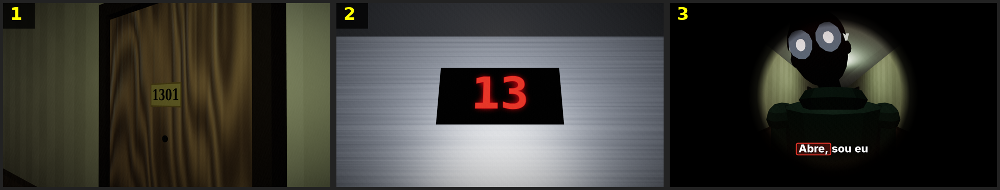

# Storyboard: andar13-longo (3d)

| panel | scene | t (s) | type | title | stat |
|---|---|---|---|---|---|
| 1 | hook | 67.4 | question | O andar que não existe |  |
| 2 | estive | 123.2 | stat |  |  |
| 3 | historia | 165.5 | object | Será que eu voltei? |  |
| 4 | predio |  | object | 21 andares, sem o 13º |  |
| 5 | botao |  | object | Do 12 direto pro 14 |  |
| 6 | porteiro |  | object | Seu Ivo, o porteiro |  |
| 7 | meianoite |  | object | Nunca depois da meia-noite |  |
| 8 | noite |  | object | Duas da manhã |  |
| 9 | andares |  | process |  |  |
| 10 | tranco |  | object | O elevador parou |  |
| 11 | painel |  | question | Um número que não existe |  |
| 12 | treze |  | stat | Treze. | 13 |
| 13 | corredor |  | object | Um corredor igualzinho ao meu |  |
| 14 | placas |  | object |  |  |
| 15 | respira |  | object | Como uma respiração |  |
| 16 | passo |  | process |  |  |
| 17 | fundo |  | process | Uma porta entreaberta |  |
| 18 | placa |  | comparison | Apartamento 1302 |  |
| 19 | abaixo |  | map |  |  |
| 20 | perto |  | object | Alguém chamou meu nome |  |
| 21 | minhavoz |  | object | Era a minha voz |  |
| 22 | olhos |  | object |  |  |
| 23 | pisca |  | comparison | Um segundo depois de mim |  |
| 24 | corri |  | process | Corri pro elevador |  |
| 25 | viu |  | object | Tinha alguém no fim do corredor |  |
| 26 | casaco |  | object | Com o meu casaco |  |
| 27 | subiu |  | process |  |  |
| 28 | feliz |  | object |  |  |
| 29 | casa |  | object | Foi só cansaço |  |
| 30 | tres |  | stat | Três da manhã |  |
| 31 | passos |  | process |  |  |
| 32 | sombra |  | object | A sombra de dois pés |  |
| 33 | batidas |  | process | Três batidas |  |
| 34 | levantei |  | object |  |  |
| 35 | olhomagico |  | object | Ali, parado, estava eu |  |
| 36 | sussurro |  | object | Abre, sou eu |  |
| 37 | errado |  | closing | Você entrou no apartamento errado |  |
| 38 | naoabri |  | object | Toda noite, às três da manhã |  |
| 39 | cta |  | closing | Confira o número antes de sair |  |
| 40 | pergunta |  | closing | Você abriria a porta? |  |
