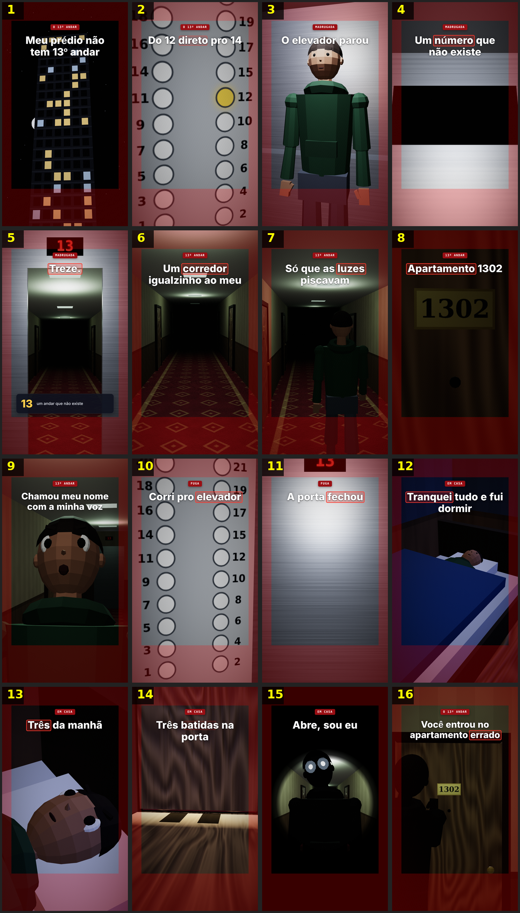

# Storyboard: andar13 (3d)

| panel | scene | t (s) | type | title | stat |
|---|---|---|---|---|---|
| 1 | hook | 1.99 | question | Meu prédio não tem 13º andar |  |
| 2 | botao | 5.36 | object | Do 12 direto pro 14 |  |
| 3 | parou | 9.25 | object | O elevador parou |  |
| 4 | painel | 12.65 | question | Um número que não existe |  |
| 5 | treze | 15.49 | stat | Treze. | 13 |
| 6 | corredor | 19.33 | object | Um corredor igualzinho ao meu |  |
| 7 | luzes | 23.91 | process | Só que as luzes piscavam |  |
| 8 | placa | 28.41 | comparison | Apartamento 1302 |  |
| 9 | voz | 32.51 | object | Chamou meu nome com a minha voz |  |
| 10 | fuga | 36.35 | process | Corri pro elevador |  |
| 11 | fechou | 39.39 | object | A porta fechou |  |
| 12 | casa | 41.88 | object | Tranquei tudo e fui dormir |  |
| 13 | tres | 44.67 | stat | Três da manhã |  |
| 14 | batidas | 48.2 | process | Três batidas na porta |  |
| 15 | sussurro | 52.36 | object | Abre, sou eu |  |
| 16 | fim | 56.01 | closing | Você entrou no apartamento errado |  |
