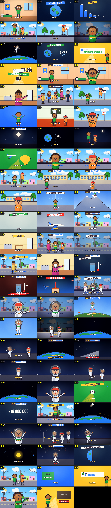

# Storyboard: imagina-gravidade (flat2d)

| panel | scene | t (s) | type | title | stat |
|---|---|---|---|---|---|
| 1 | hook | 1.6 | object |  |  |
| 2 | fall | 4.24 | object |  |  |
| 3 | again | 7.28 | object |  |  |
| 4 | power | 10.84 | object |  |  |
| 5 | dunk | 13.29 | object |  |  |
| 6 | air | 16.95 | object |  |  |
| 7 | space | 21.93 | object |  |  |
| 8 | real | 28.02 | object |  |  |
| 9 | guess | 33.59 | object |  |  |
| 10 | go | 36.46 | object |  |  |
| 11 | bed | 40.99 | object |  |  |
| 12 | voando | 44.67 | object |  |  |
| 13 | mae | 48.3 | object |  |  |
| 14 | street | 54.29 | object |  |  |
| 15 | dunk2 | 59.89 | object |  |  |
| 16 | strong | 69.54 | object |  |  |
| 17 | fridge | 78.98 | object |  |  |
| 18 | melhor | 83.61 | object |  |  |
| 19 | moon | 88.91 | object |  |  |
| 20 | moonaway | 99.24 | object |  |  |
| 21 | tides | 108 | object |  |  |
| 22 | brasil | 116.73 | object |  |  |
| 23 | aposta | 122.48 | object |  |  |
| 24 | acai | 125.53 | object |  |  |
| 25 | contest | 132.34 | object |  |  |
| 26 | wall | 142.03 | object |  |  |
| 27 | tired | 150 | object |  |  |
| 28 | respirar | 154.43 | object |  |  |
| 29 | column | 161.5 | object |  |  |
| 30 | everest | 170.28 | object |  |  |
| 31 | oxygen | 177.98 | object |  |  |
| 32 | planes | 185.24 | object |  |  |
| 33 | kangaroo | 191.14 | object |  |  |
| 34 | cup | 196.36 | object |  |  |
| 35 | masks | 203.44 | object |  |  |
| 36 | rain | 212.26 | object |  |  |
| 37 | bigkick | 221.53 | object |  |  |
| 38 | mae2 | 227.39 | object |  |  |
| 39 | boil100 | 234.55 | object |  |  |
| 40 | boil37 | 245.06 | object |  |  |
| 41 | armstrong | 254.9 | object |  |  |
| 42 | suits | 263.44 | object |  |  |
| 43 | coca | 270.1 | object |  |  |
| 44 | voltar | 274.28 | object |  |  |
| 45 | jump60 | 282.26 | object |  |  |
| 46 | bairro | 288.37 | object |  |  |
| 47 | darksky | 293.74 | object |  |  |
| 48 | molecules | 303.19 | object |  |  |
| 49 | nosound | 316.36 | object |  |  |
| 50 | bullet | 330.21 | object |  |  |
| 51 | car | 342.38 | object |  |  |
| 52 | garage | 352.66 | object |  |  |
| 53 | bora | 357.78 | object |  |  |
| 54 | kick | 363.72 | object |  |  |
| 55 | up | 368.65 | object |  |  |
| 56 | chutei | 371.77 | object |  |  |
| 57 | gol | 375.58 | object |  |  |
| 58 | d24 | 383.47 | object |  |  |
| 59 | jumpkid | 391.48 | object |  |  |
| 60 | satellite | 398.1 | object |  |  |
| 61 | ninguem | 402.37 | object |  |  |
| 62 | ropes | 408.98 | object |  |  |
| 63 | dot | 417.92 | object |  |  |
| 64 | sunorbit | 424.89 | object |  |  |
| 65 | dust | 432.08 | object |  |  |
| 66 | realife | 442.06 | object |  |  |
| 67 | holds | 452.74 | object |  |  |
| 68 | question | 461.28 | object |  |  |
| 69 | comment | 467.6 | object |  |  |
| 70 | ball | 471.78 | object |  |  |
| 71 | endcard | 479.25 | object |  |  |
