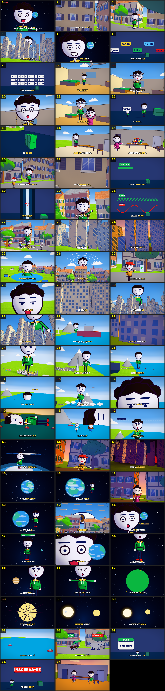

# Storyboard: imagina-tamanho (2.5d_cartoon)

| panel | scene | t (s) | type | title | stat |
|---|---|---|---|---|---|
| 1 | hook | 2.65 | object | E se você DOBRASSE de tamanho todo dia? |  |
| 2 | grow | 5.99 | object |   |  |
| 3 | fun | 10.18 | object |   |  |
| 4 | building | 13.81 | object |   |  |
| 5 | earthhand | 17.26 | object |   |  |
| 6 | real | 22.76 | object |   |  |
| 7 | guess | 28.94 | object |   |  |
| 8 | normal | 34.47 | object | 1,60 metro |  |
| 9 | wake | 37.97 | object | 3,20 metros |  |
| 10 | cama | 40.62 | object |   |  |
| 11 | mae | 43.98 | object |   |  |
| 12 | surprise | 51.11 | object |   |  |
| 13 | cube | 60.07 | object |   |  |
| 14 | door | 65.27 | object |   |  |
| 15 | food | 69.67 | object |   |  |
| 16 | dunk | 74.34 | object |   |  |
| 17 | elephant | 80.12 | object | 6,40 metros |  |
| 18 | bones | 89.3 | object |   |  |
| 19 | crack | 97.25 | object |   |  |
| 20 | deal | 102.26 | object |   |  |
| 21 | voice | 108.54 | object |   |  |
| 22 | olhando | 113.8 | object |   |  |
| 23 | day5 | 120.77 | object | 25,6 metros |  |
| 24 | heat | 130.95 | object |   |  |
| 25 | lake | 138.95 | object |   |  |
| 26 | infra | 148.04 | object |   |  |
| 27 | app | 155.71 | object |   |  |
| 28 | fome | 159.65 | object |   |  |
| 29 | cristo | 163.71 | object | 51 metros |  |
| 30 | day7 | 168.08 | object | 102 metros |  |
| 31 | steps | 175.13 | object |   |  |
| 32 | carrier | 184.12 | object | 205 metros |  |
| 33 | news | 191.1 | object |   |  |
| 34 | citymeal | 198.6 | object | 410 metros |  |
| 35 | burj | 207.69 | object | 819 metros |  |
| 36 | tosea | 216.8 | object | 6,5 quilômetros |  |
| 37 | ocean | 226.24 | object |   |  |
| 38 | clouds | 237 | object | 13 quilômetros |  |
| 39 | frio | 243.57 | object |   |  |
| 40 | island | 251.03 | object |   |  |
| 41 | science | 258.41 | object |   |  |
| 42 | karman | 266.47 | object | 105 quilômetros |  |
| 43 | iss | 277.09 | object | 419 quilômetros |  |
| 44 | selfie | 283.93 | object |   |  |
| 45 | sink | 291.62 | object |   |  |
| 46 | orbit | 302.22 | object | 1.678 quilômetros |  |
| 47 | brazil | 312.78 | object | 6.710 quilômetros |  |
| 48 | maecall | 318.59 | object |   |  |
| 49 | pilates | 325.85 | object | 13.422 quilômetros |  |
| 50 | eye | 334.84 | object |   |  |
| 51 | soccer | 344.73 | object | 107 mil quilômetros |  |
| 52 | swap | 355.75 | object |   |  |
| 53 | hand | 363.73 | object |   |  |
| 54 | moon | 372.08 | object | 429 mil quilômetros |  |
| 55 | jupiter | 380.67 | object | 859 mil quilômetros |  |
| 56 | ball | 390.12 | object |   |  |
| 57 | fusion | 401.98 | object |   |  |
| 58 | star | 409.08 | object | Uma estrela |  |
| 59 | twosuns | 413.59 | object |   |  |
| 60 | chaos | 420.61 | object |   |  |
| 61 | reallife | 432.92 | object |   |  |
| 62 | ant | 444.33 | object |   |  |
| 63 | ask | 453.73 | object |   |  |
| 64 | sub | 460.78 | object |   |  |
| 65 | endcard | 475.1 | object |   |  |
