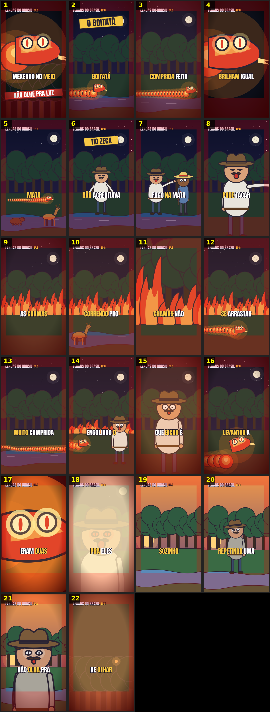

# Storyboard: lenda-boitata (flat2d)

| panel | scene | t (s) | type | title | stat |
|---|---|---|---|---|---|
| 1 | hook | 2.29 | object |  |  |
| 2 | title | 4.59 | object |  |  |
| 3 | snake | 6.85 | object |  |  |
| 4 | eyes | 9.38 | object |  |  |
| 5 | protect | 11.19 | object |  |  |
| 6 | zeca | 12.77 | object |  |  |
| 7 | order | 15.55 | object |  |  |
| 8 | lenda | 19.91 | object |  |  |
| 9 | blaze | 23.24 | object |  |  |
| 10 | flee | 25.62 | object |  |  |
| 11 | flame | 27.66 | object |  |  |
| 12 | crawl | 30.04 | object |  |  |
| 13 | long | 32.37 | object |  |  |
| 14 | toward | 35.81 | object |  |  |
| 15 | deus | 38.78 | object |  |  |
| 16 | rise | 40.77 | object |  |  |
| 17 | fireeyes | 42.73 | object |  |  |
| 18 | look | 44.83 | object |  |  |
| 19 | morning | 48.27 | object |  |  |
| 20 | blind | 52.15 | object |  |  |
| 21 | luz | 56.37 | object |  |  |
| 22 | you | 60.79 | object |  |  |
