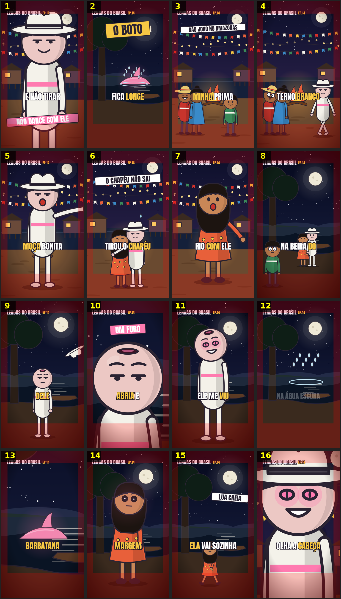

# Storyboard: lenda-boto (flat2d)

| panel | scene | t (s) | type | title | stat |
|---|---|---|---|---|---|
| 1 | hook | 3.41 | object |  |  |
| 2 | title | 6.65 | object |  |  |
| 3 | party | 12.12 | object |  |  |
| 4 | arrive | 19.01 | object |  |  |
| 5 | ask | 23.38 | object |  |  |
| 6 | dance | 28.9 | object |  |  |
| 7 | rosa | 34.04 | object |  |  |
| 8 | follow | 37.95 | object |  |  |
| 9 | hat | 40.6 | object |  |  |
| 10 | hole | 45.11 | object |  |  |
| 11 | saw | 48.34 | object |  |  |
| 12 | jump | 49.81 | object |  |  |
| 13 | fin | 52.23 | object |  |  |
| 14 | glazed | 55.3 | object |  |  |
| 15 | moon | 59.21 | object |  |  |
| 16 | end | 64.52 | object |  |  |
