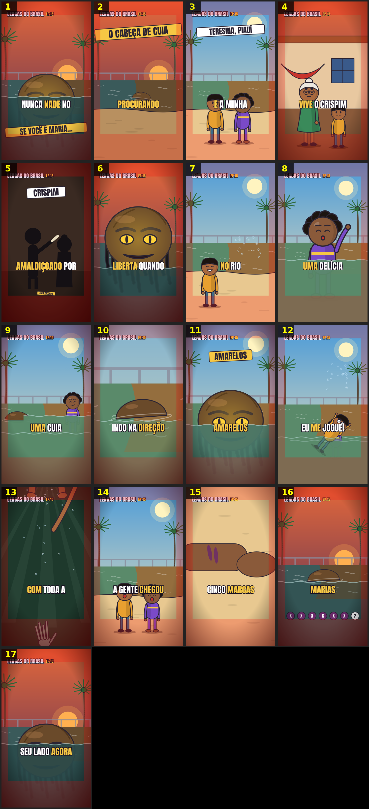

# Storyboard: lenda-cabeca-de-cuia (flat2d)

| panel | scene | t (s) | type | title | stat |
|---|---|---|---|---|---|
| 1 | hook | 3.02 | object |  |  |
| 2 | title | 6.33 | object |  |  |
| 3 | city | 11.55 | object |  |  |
| 4 | vo | 15.82 | object |  |  |
| 5 | crispim | 19.04 | object |  |  |
| 6 | curse | 24.77 | object |  |  |
| 7 | laugh | 30.7 | object |  |  |
| 8 | vem | 34.55 | object |  |  |
| 9 | dome | 38.09 | object |  |  |
| 10 | spin | 42.25 | object |  |  |
| 11 | eyes | 46.67 | object |  |  |
| 12 | sink | 50.17 | object |  |  |
| 13 | under | 53.19 | object |  |  |
| 14 | sand | 55.48 | object |  |  |
| 15 | marks | 58.55 | object |  |  |
| 16 | six | 62.58 | object |  |  |
| 17 | end | 67.09 | object |  |  |
