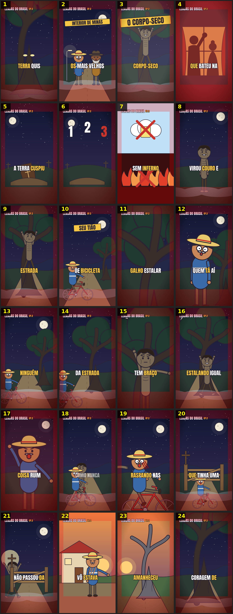

# Storyboard: lenda-corpo-seco (flat2d)

| panel | scene | t (s) | type | title | stat |
|---|---|---|---|---|---|
| 1 | open | 2.1 | object |  |  |
| 2 | minas | 5.04 | object |  |  |
| 3 | title | 7.1 | object |  |  |
| 4 | window | 10.36 | object |  |  |
| 5 | grave | 13.69 | object |  |  |
| 6 | three | 15.9 | object |  |  |
| 7 | nowhere | 17.51 | object |  |  |
| 8 | dry | 19.41 | object |  |  |
| 9 | tree | 24.15 | object |  |  |
| 10 | ride | 30.12 | object |  |  |
| 11 | snap | 34.1 | object |  |  |
| 12 | quem | 36.2 | object |  |  |
| 13 | quiet | 38.39 | object |  |  |
| 14 | moving | 41.75 | object |  |  |
| 15 | arm | 44.59 | object |  |  |
| 16 | descend | 48.96 | object |  |  |
| 17 | sai | 52.23 | object |  |  |
| 18 | chase | 54.3 | object |  |  |
| 19 | claws | 56.88 | object |  |  |
| 20 | gate | 60.68 | object |  |  |
| 21 | stop | 63.95 | object |  |  |
| 22 | dawn | 68.01 | object |  |  |
| 23 | dead | 72.02 | object |  |  |
| 24 | you | 76.67 | object |  |  |
