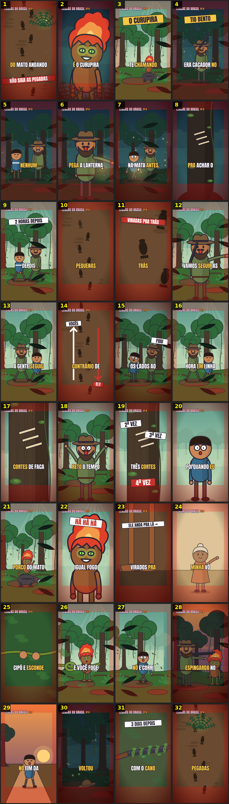

# Storyboard: lenda-curupira (flat2d)

| panel | scene | t (s) | type | title | stat |
|---|---|---|---|---|---|
| 1 | hook | 2.01 | object |  |  |
| 2 | eyes | 4.08 | object |  |  |
| 3 | title | 5.09 | object |  |  |
| 4 | bento | 7.57 | object |  |  |
| 5 | brave | 11.11 | object |  |  |
| 6 | lanterna | 15.83 | object |  |  |
| 7 | enter | 19.63 | object |  |  |
| 8 | mark | 23.85 | object |  |  |
| 9 | hours | 26.67 | object |  |  |
| 10 | prints | 28.75 | object |  |  |
| 11 | back | 30.64 | object |  |  |
| 12 | seguir | 33.1 | object |  |  |
| 13 | follow | 35.16 | object |  |  |
| 14 | arrows | 38.84 | object |  |  |
| 15 | whistle | 44.09 | object |  |  |
| 16 | walk | 47.59 | object |  |  |
| 17 | same | 51.81 | object |  |  |
| 18 | naopode | 55.94 | object |  |  |
| 19 | loop | 61 | object |  |  |
| 20 | saw | 64.21 | object |  |  |
| 21 | rider | 65.57 | object |  |  |
| 22 | kid | 67.89 | object |  |  |
| 23 | feet | 70.22 | object |  |  |
| 24 | vo | 72.37 | object |  |  |
| 25 | knot | 74.59 | object |  |  |
| 26 | untie | 77.05 | object |  |  |
| 27 | run | 78.96 | object |  |  |
| 28 | aim | 81.7 | object |  |  |
| 29 | road | 84.44 | object |  |  |
| 30 | never | 86.21 | object |  |  |
| 31 | gun | 89.87 | object |  |  |
| 32 | you | 94.32 | object |  |  |
