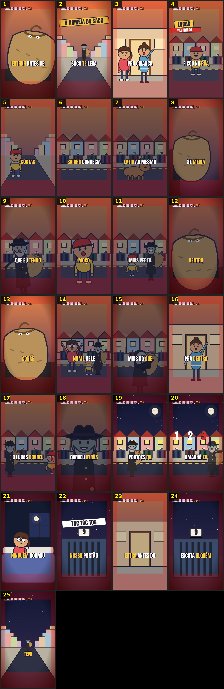

# Storyboard: lenda-homem-do-saco (flat2d)

| panel | scene | t (s) | type | title | stat |
|---|---|---|---|---|---|
| 1 | sack | 2.07 | object |  |  |
| 2 | title | 4.43 | object |  |  |
| 3 | mom | 7.31 | object |  |  |
| 4 | lucas | 11 | object |  |  |
| 5 | far | 15.9 | object |  |  |
| 6 | nobody | 19.26 | object |  |  |
| 7 | dogs | 22.45 | object |  |  |
| 8 | wobble | 25.3 | object |  |  |
| 9 | velho | 28.6 | object |  |  |
| 10 | ask | 31.4 | object |  |  |
| 11 | closer | 33.3 | object |  |  |
| 12 | untie | 37.28 | object |  |  |
| 13 | peek | 40.59 | object |  |  |
| 14 | shout | 42.33 | object |  |  |
| 15 | turn | 45.78 | object |  |  |
| 16 | mae | 48.91 | object |  |  |
| 17 | run | 50.65 | object |  |  |
| 18 | smile | 52.79 | object |  |  |
| 19 | count | 56.06 | object |  |  |
| 20 | numbers | 59.52 | object |  |  |
| 21 | awake | 62.5 | object |  |  |
| 22 | knock | 66.21 | object |  |  |
| 23 | home | 70.07 | object |  |  |
| 24 | inside | 73.32 | object |  |  |
| 25 | you | 76.75 | object |  |  |
