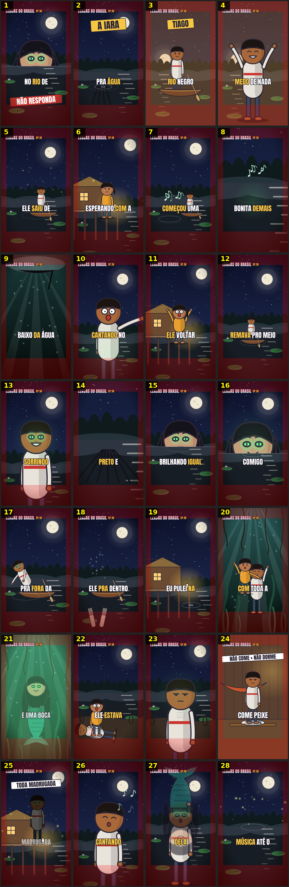

# Storyboard: lenda-iara (flat2d)

| panel | scene | t (s) | type | title | stat |
|---|---|---|---|---|---|
| 1 | hook | 2.34 | object |  |  |
| 2 | title | 4.69 | object |  |  |
| 3 | tiago | 7.79 | object |  |  |
| 4 | forte | 11.22 | object |  |  |
| 5 | night | 14.32 | object |  |  |
| 6 | pier | 17.41 | object |  |  |
| 7 | music | 20.2 | object |  |  |
| 8 | voice | 23.18 | object |  |  |
| 9 | below | 25.65 | object |  |  |
| 10 | ouvindo | 28.87 | object |  |  |
| 11 | shout | 31.46 | object |  |  |
| 12 | rowing | 33.97 | object |  |  |
| 13 | glazed | 36.36 | object |  |  |
| 14 | hair | 39.5 | object |  |  |
| 15 | eyes | 42.95 | object |  |  |
| 16 | vem | 45.72 | object |  |  |
| 17 | lean | 48.46 | object |  |  |
| 18 | grab | 52.14 | object |  |  |
| 19 | jump | 54.62 | object |  |  |
| 20 | pull | 56.47 | object |  |  |
| 21 | reveal | 60.36 | object |  |  |
| 22 | bank | 65.22 | object |  |  |
| 23 | stare | 68.23 | object |  |  |
| 24 | fish | 71.01 | object |  |  |
| 25 | trapiche | 73.62 | object |  |  |
| 26 | sing | 76.72 | object |  |  |
| 27 | voz | 79.01 | object |  |  |
| 28 | you | 83.81 | object |  |  |
