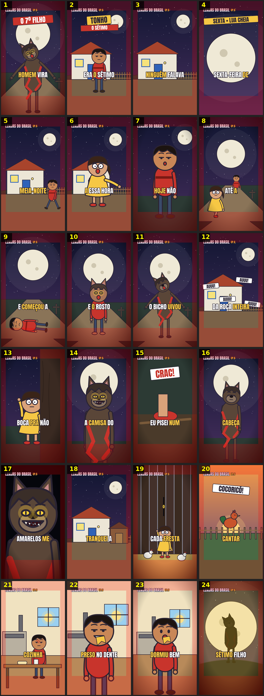

# Storyboard: lenda-lobisomem (flat2d)

| panel | scene | t (s) | type | title | stat |
|---|---|---|---|---|---|
| 1 | hook | 2.33 | object |  |  |
| 2 | tonho | 5.33 | object |  |  |
| 3 | farm | 8.06 | object |  |  |
| 4 | moon | 10.45 | object |  |  |
| 5 | sneak | 12.73 | object |  |  |
| 6 | ju | 16.12 | object |  |  |
| 7 | hoje | 19.33 | object |  |  |
| 8 | follow | 21.64 | object |  |  |
| 9 | roll | 24.17 | object |  |  |
| 10 | change | 29.03 | object |  |  |
| 11 | howl | 32.72 | object |  |  |
| 12 | dogs | 36.14 | object |  |  |
| 13 | hide | 38.97 | object |  |  |
| 14 | big | 42.57 | object |  |  |
| 15 | snap | 45.22 | object |  |  |
| 16 | turn | 46.59 | object |  |  |
| 17 | eyes | 48.28 | object |  |  |
| 18 | run | 50.85 | object |  |  |
| 19 | coop | 53.09 | object |  |  |
| 20 | dawn | 54.83 | object |  |  |
| 21 | kitchen | 57.75 | object |  |  |
| 22 | scrap | 61.15 | object |  |  |
| 23 | bomdia | 64.53 | object |  |  |
| 24 | you | 70.03 | object |  |  |
