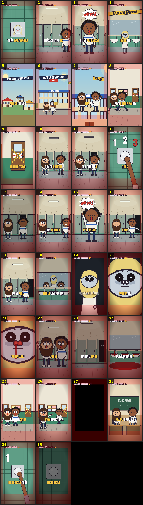

# Storyboard: lenda-loira-do-banheiro (flat2d)

| panel | scene | t (s) | type | title | stat |
|---|---|---|---|---|---|
| 1 | flush1 | 0.9 | object |  |  |
| 2 | kick1 | 2.38 | object |  |  |
| 3 | swear1 | 3.87 | object |  |  |
| 4 | title | 6.15 | object |  |  |
| 5 | schools | 8.67 | object |  |  |
| 6 | school | 12.48 | object |  |  |
| 7 | bia | 15.72 | object |  |  |
| 8 | hall | 18.97 | object |  |  |
| 9 | tape | 21.54 | object |  |  |
| 10 | dare | 24.2 | object |  |  |
| 11 | pull | 26.52 | object |  |  |
| 12 | flush3 | 28.63 | object |  |  |
| 13 | wait | 29.93 | object |  |  |
| 14 | kick2 | 31.4 | object |  |  |
| 15 | swear2 | 33.36 | object |  |  |
| 16 | nada | 36.27 | object |  |  |
| 17 | flicker | 39.23 | object |  |  |
| 18 | mirror | 42.57 | object |  |  |
| 19 | pale | 44.42 | object |  |  |
| 20 | cotton | 46.78 | object |  |  |
| 21 | red | 49.89 | object |  |  |
| 22 | corre | 51.83 | object |  |  |
| 23 | door | 53.91 | object |  |  |
| 24 | taps | 57.01 | object |  |  |
| 25 | run | 59.27 | object |  |  |
| 26 | back | 60.83 | object |  |  |
| 27 | bag | 62.39 | object |  |  |
| 28 | silent | 64.59 | object |  |  |
| 29 | twice | 67.84 | object |  |  |
| 30 | you | 72.16 | object |  |  |
