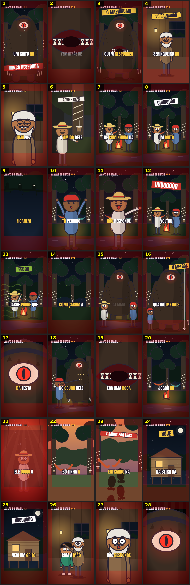

# Storyboard: lenda-mapinguari (flat2d)

| panel | scene | t (s) | type | title | stat |
|---|---|---|---|---|---|
| 1 | hook | 1.76 | object |  |  |
| 2 | mouth | 3.85 | object |  |  |
| 3 | title | 5.38 | object |  |  |
| 4 | vo | 8.65 | object |  |  |
| 5 | tear | 12.62 | object |  |  |
| 6 | seringa | 15.38 | object |  |  |
| 7 | camp | 19.19 | object |  |  |
| 8 | grito | 23.66 | object |  |  |
| 9 | monkeys | 27.46 | object |  |  |
| 10 | quemta | 31.22 | object |  |  |
| 11 | calaboca | 35.2 | object |  |  |
| 12 | closer | 39.37 | object |  |  |
| 13 | smell | 43.91 | object |  |  |
| 14 | trees | 47.34 | object |  |  |
| 15 | emerge | 49.28 | object |  |  |
| 16 | size | 51.14 | object |  |  |
| 17 | eye | 53.41 | object |  |  |
| 18 | shoot | 56.79 | object |  |  |
| 19 | belly | 60.68 | object |  |  |
| 20 | dive | 63.64 | object |  |  |
| 21 | under | 68.4 | object |  |  |
| 22 | dawn | 73.52 | object |  |  |
| 23 | prints | 77.77 | object |  |  |
| 24 | today | 81.67 | object |  |  |
| 25 | again | 85.07 | object |  |  |
| 26 | hand | 88.7 | object |  |  |
| 27 | voltou | 92.2 | object |  |  |
| 28 | you | 95.61 | object |  |  |
