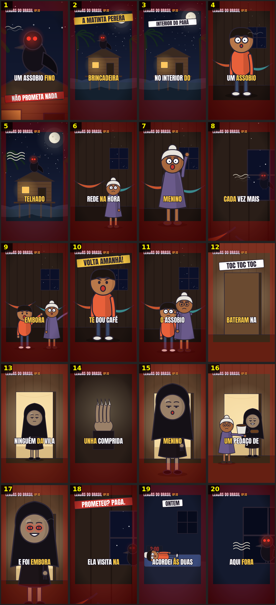

# Storyboard: lenda-matinta (flat2d)

| panel | scene | t (s) | type | title | stat |
|---|---|---|---|---|---|
| 1 | hook | 1.99 | object |  |  |
| 2 | title | 4.86 | object |  |  |
| 3 | house | 9.11 | object |  |  |
| 4 | woke | 13.87 | object |  |  |
| 5 | roof | 16.94 | object |  |  |
| 6 | vo | 19.67 | object |  |  |
| 7 | quieto | 23.22 | object |  |  |
| 8 | closer | 26.66 | object |  |  |
| 9 | gritei | 29.15 | object |  |  |
| 10 | promise | 31.71 | object |  |  |
| 11 | tapou | 35.59 | object |  |  |
| 12 | knock | 38.69 | object |  |  |
| 13 | velha | 41.08 | object |  |  |
| 14 | unha | 43.86 | object |  |  |
| 15 | cobrar | 46.66 | object |  |  |
| 16 | pay | 49.34 | object |  |  |
| 17 | smile | 52.48 | object |  |  |
| 18 | rule | 56.77 | object |  |  |
| 19 | today | 60.19 | object |  |  |
| 20 | outside | 63.26 | object |  |  |
