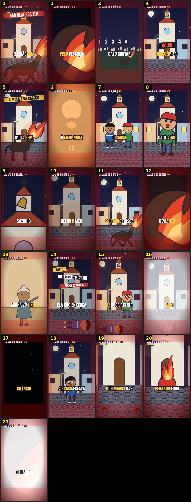

# Storyboard: lenda-mula-sem-cabeca (flat2d)

| panel | scene | t (s) | type | title | stat |
|---|---|---|---|---|---|
| 1 | hook | 1.01 | object |  |  |
| 2 | fire | 2.82 | object |  |  |
| 3 | vilas | 5.46 | object |  |  |
| 4 | town | 9.31 | object |  |  |
| 5 | title | 12.17 | object |  |  |
| 6 | curse | 17.37 | object |  |  |
| 7 | boys | 24.03 | object |  |  |
| 8 | beto | 28.62 | object |  |  |
| 9 | bell | 31.55 | object |  |  |
| 10 | neigh | 34.51 | object |  |  |
| 11 | street | 37.72 | object |  |  |
| 12 | neck | 40.18 | object |  |  |
| 13 | vo | 42.02 | object |  |  |
| 14 | lie | 46.34 | object |  |  |
| 15 | notme | 51.53 | object |  |  |
| 16 | pass | 55.88 | object |  |  |
| 17 | silence | 58.45 | object |  |  |
| 18 | empty | 60.94 | object |  |  |
| 19 | prints | 63.93 | object |  |  |
| 20 | cap | 66.46 | object |  |  |
| 21 | you | 70.67 | object |  |  |
