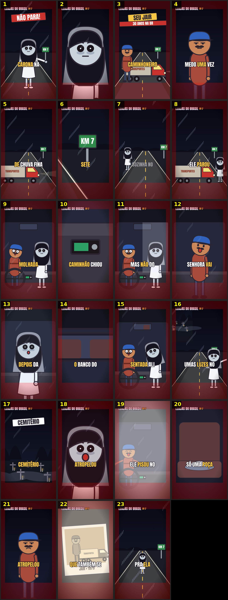

# Storyboard: lenda-mulher-de-branco (flat2d)

| panel | scene | t (s) | type | title | stat |
|---|---|---|---|---|---|
| 1 | hook | 2.89 | object |  |  |
| 2 | face | 5.5 | object |  |  |
| 3 | jair | 7.61 | object |  |  |
| 4 | medo | 9.92 | object |  |  |
| 5 | rain | 11.8 | object |  |  |
| 6 | km | 13.46 | object |  |  |
| 7 | found | 16.38 | object |  |  |
| 8 | stop | 18.93 | object |  |  |
| 9 | cab | 21.53 | object |  |  |
| 10 | radio | 24.39 | object |  |  |
| 11 | fog | 27.54 | object |  |  |
| 12 | pergunta | 30.14 | object |  |  |
| 13 | resposta | 32.89 | object |  |  |
| 14 | mirror | 36.65 | object |  |  |
| 15 | still | 39.46 | object |  |  |
| 16 | curve | 42.3 | object |  |  |
| 17 | cemetery | 44.46 | object |  |  |
| 18 | atropelou | 46.49 | object |  |  |
| 19 | brake | 48.54 | object |  |  |
| 20 | seat | 52.21 | object |  |  |
| 21 | pai | 55.4 | object |  |  |
| 22 | photo | 59.18 | object |  |  |
| 23 | you | 63.58 | object |  |  |
