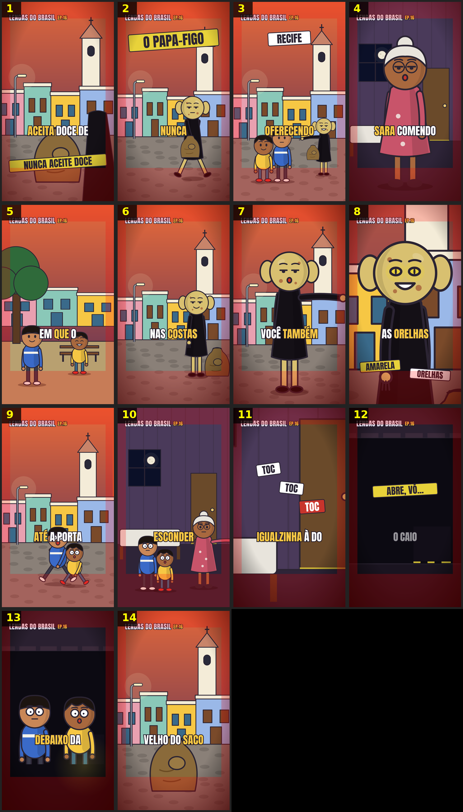

# Storyboard: lenda-papa-figo (flat2d)

| panel | scene | t (s) | type | title | stat |
|---|---|---|---|---|---|
| 1 | hook | 3.24 | object |  |  |
| 2 | title | 6.13 | object |  |  |
| 3 | street | 9.67 | object |  |  |
| 4 | vo | 14.82 | object |  |  |
| 5 | square | 20.56 | object |  |  |
| 6 | corner | 28.01 | object |  |  |
| 7 | offer | 33.22 | object |  |  |
| 8 | close | 38.78 | object |  |  |
| 9 | run | 44.75 | object |  |  |
| 10 | lock | 49.98 | object |  |  |
| 11 | knock | 55.05 | object |  |  |
| 12 | voice | 58.55 | object |  |  |
| 13 | under | 62.05 | object |  |  |
| 14 | end | 66.34 | object |  |  |
