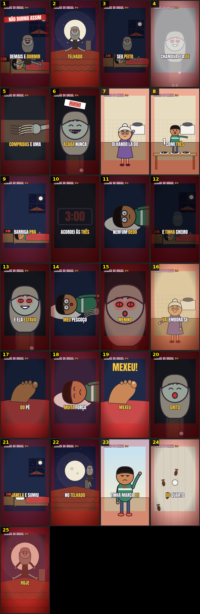

# Storyboard: lenda-pisadeira (flat2d)

| panel | scene | t (s) | type | title | stat |
|---|---|---|---|---|---|
| 1 | hook | 2.18 | object |  |  |
| 2 | roof | 4.41 | object |  |  |
| 3 | land | 5.86 | object |  |  |
| 4 | title | 8.09 | object |  |  |
| 5 | nails | 9.97 | object |  |  |
| 6 | laugh | 11.58 | object |  |  |
| 7 | vo | 15.14 | object |  |  |
| 8 | feast | 19.66 | object |  |  |
| 9 | bed | 23.37 | object |  |  |
| 10 | clock | 25.76 | object |  |  |
| 11 | frozen | 28.64 | object |  |  |
| 12 | weight | 33.01 | object |  |  |
| 13 | eyes | 36.65 | object |  |  |
| 14 | neck | 39.48 | object |  |  |
| 15 | janta | 42.2 | object |  |  |
| 16 | lembrei | 46.55 | object |  |  |
| 17 | foot | 49.66 | object |  |  |
| 18 | force | 51.7 | object |  |  |
| 19 | toe | 53.56 | object |  |  |
| 20 | scream | 55.07 | object |  |  |
| 21 | window | 56.31 | object |  |  |
| 22 | gone | 57.44 | object |  |  |
| 23 | morning | 60.06 | object |  |  |
| 24 | ceiling | 63.04 | object |  |  |
| 25 | you | 67.34 | object |  |  |
