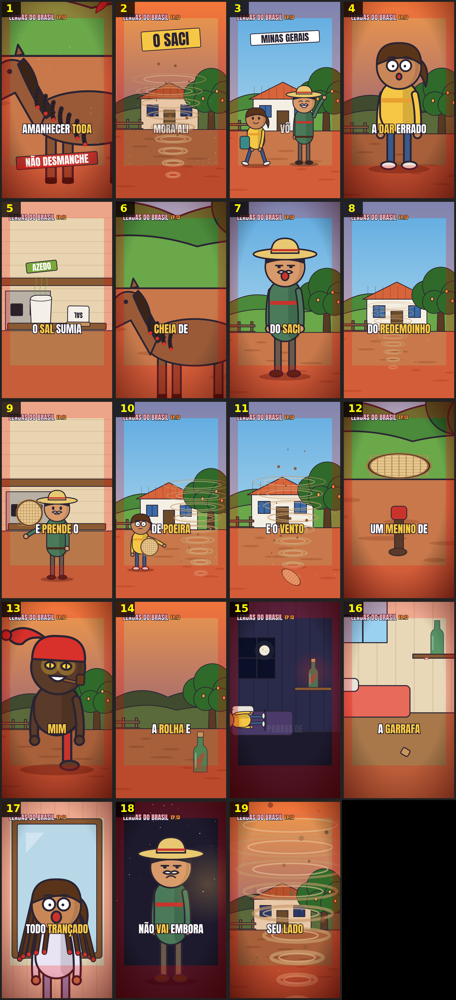

# Storyboard: lenda-saci (flat2d)

| panel | scene | t (s) | type | title | stat |
|---|---|---|---|---|---|
| 1 | hook | 3.1 | object |  |  |
| 2 | title | 6.73 | object |  |  |
| 3 | farm | 9.96 | object |  |  |
| 4 | wrong | 12.41 | object |  |  |
| 5 | milk | 14.5 | object |  |  |
| 6 | mane | 17.6 | object |  |  |
| 7 | vo | 20.66 | object |  |  |
| 8 | whirlsmall | 23.55 | object |  |  |
| 9 | teach | 28.3 | object |  |  |
| 10 | whirl | 32.92 | object |  |  |
| 11 | throw | 36.18 | object |  |  |
| 12 | under | 39.28 | object |  |  |
| 13 | cap | 42.08 | object |  |  |
| 14 | smoke | 46.16 | object |  |  |
| 15 | night | 50.1 | object |  |  |
| 16 | morning | 53.57 | object |  |  |
| 17 | mirror | 57.89 | object |  |  |
| 18 | vo2 | 62.78 | object |  |  |
| 19 | end | 67.61 | object |  |  |
