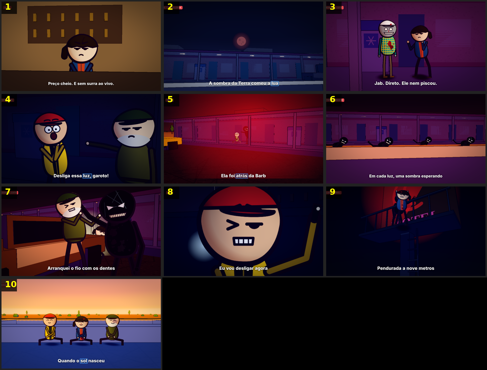

# Storyboard: motel-lua-vermelha (2.5d_cartoon)

| panel | scene | t (s) | type | title | stat |
|---|---|---|---|---|---|
| 1 | p01 | 100 | object | 1961. A última lua de sangue. |  |
| 2 | p02 | 150 | object | Onze sombras pintadas na parede |  |
| 3 | p03 | 200 | object | Eu tinha oito anos |  |
| 4 | a01 | 250 | object | Mari Delgado: gerente de tudo |  |
| 5 | a02 | 300 | object | Rodovia Extraterrestre |  |
| 6 | a03 | 350 | object | Catorze vitórias, um nariz quebrado |  |
| 7 | a04 | 400 | object | A Sofia me ligou |  |
| 8 | a05 | 450 | object | Tranca a porta. É lua de sangue. |  |
| 9 | a06 | 500 | object | Eu tranco a porta mesmo assim |  |
| 10 | a07 | 550 | object | O primeiro problema chegou |  |
| 11 | a08 |  | object | Trezentos mil inscritos |  |
| 12 | a09 |  | object | Eu quero o quarto onze |  |
| 13 | a10 |  | object | Preço cheio. E sem surra ao vivo. |  |
| 14 | a11 |  | object | Pode repetir olhando pra câmera? |  |
| 15 | a12 |  | object | Seu Hank, rabugento profissional |  |
| 16 | a13 |  | object | Tranca a porta, apaga tudo e reza |  |
| 17 | a14 |  | object | Então reza mais alto |  |
| 18 | a15 |  | object | Barb e Gary, aposentados de Ohio |  |
| 19 | a16 |  | object | Sorria. Sorria. Sorria. |  |
| 20 | a17 |  | object | A sombra da Terra comeu a lua |  |
| 21 | b01 |  | object | O Kev viu primeiro |  |
| 22 | b02 |  | object | O Gary tá parado. A sombra não tá. |  |
| 23 | b03 |  | object | Ela estava acenando |  |
| 24 | b04 |  | object | E entrou nele pela boca |  |
| 25 | b05 |  | object | Os olhos ficaram brancos |  |
| 26 | b06 |  | object | Que brincadeira é essa? |  |
| 27 | b07 |  | object | Bateu a cabeça dela no gelo |  |
| 28 | b08 |  | object | Jab. Direto. Ele nem piscou. |  |
| 29 | b09 |  | object | Gancho de fígado |  |
| 30 | b10 |  | object | Prensada contra a máquina de gelo |  |
| 31 | b11 |  | object | Me ajuda! |  |
| 32 | b12 |  | object | Um upper. E a pá de gelo. |  |
| 33 | b13 |  | object | Sem sombra, continuava sorrindo |  |
| 34 | b14 |  | object | Desliga essa luz, garoto! |  |
| 35 | b15 |  | object | Sombra só existe onde tem luz |  |
| 36 | b16 |  | object | Com a voz dela. Mas não era ela. |  |
| 37 | b17 |  | object | O neon é a porta |  |
| 38 | b18 |  | object | A lanterna acendeu sozinha |  |
| 39 | b19 |  | object | E sorria muito melhor |  |
| 40 | b20 |  | object | Ela foi atrás da Barb |  |
| 41 | b21 |  | object | Isso foi culpa minha |  |
| 42 | c01 |  | object | O transformador, a cem metros |  |
| 43 | c02 |  | object | Eu enxergo no escuro |  |
| 44 | c03 |  | object | Se for eu, eu vou te xingar |  |
| 45 | c04 |  | object | Posso postar um story? |  |
| 46 | c05 |  | object | Em cada luz, uma sombra esperando |  |
| 47 | c06 |  | object | Elas vieram rastejando |  |
| 48 | c07 |  | object | Entra na caminhonete |  |
| 49 | c08 |  | object | No meio do pulo, ele desligou |  |
| 50 | c09 |  | object | Liga. Desliga. Liga. Desliga. |  |
| 51 | c10 |  | object | Pegou o Seu Hank pelo pescoço |  |
| 52 | c11 |  | object | Arranquei o fio com os dentes |  |
| 53 | c12 |  | object | Eu tô velho, mas tô bem |  |
| 54 | c13 |  | object | Cinquenta metros no escuro |  |
| 55 | c14 |  | object | Tudo apagou. Menos o letreiro. |  |
| 56 | d01 |  | object | Trezentas mil pessoas ouvindo |  |
| 57 | d02 |  | object | Se eu filmasse, não era real |  |
| 58 | d03 |  | object | Eu vou desligar agora |  |
| 59 | d04 |  | object | E ele desligou |  |
| 60 | d05 |  | object | Só subindo no poste |  |
| 61 | d06 |  | object | A chave de roda na boca |  |
| 62 | d07 |  | object | Oi, Mari. |  |
| 63 | d08 |  | object | Rápida. Muito rápida. |  |
| 64 | d09 |  | object | Jab, jab, direto |  |
| 65 | d10 |  | object | Pendurada a nove metros |  |
| 66 | d11 |  | object | Mostra o que é um peso médio! |  |
| 67 | d12 |  | object | Ela era feita da luz |  |
| 68 | d13 |  | object | A chave de roda no neon |  |
| 69 | d14 |  | object | Um grito de trezentas mil vozes |  |
| 70 | d15 |  | object | Completamente escuro |  |
| 71 | e01 |  | object | A lua voltou a ser branca |  |
| 72 | e02 |  | object | Quando o sol nasceu |  |
| 73 | e03 |  | object | Talvez você preste |  |
| 74 | e04 |  | object | O monstro era eu, com uma lanterna |  |
| 75 | e05 |  | object | Vai pagar o quarto onze também |  |
| 76 | e06 |  | object | Agora tinha treze sombras |  |
| 77 | e07 |  | object | Foi aí que eu reparei |  |
| 78 | e08 |  | closing | A minha sombra demorou meio segundo |  |
