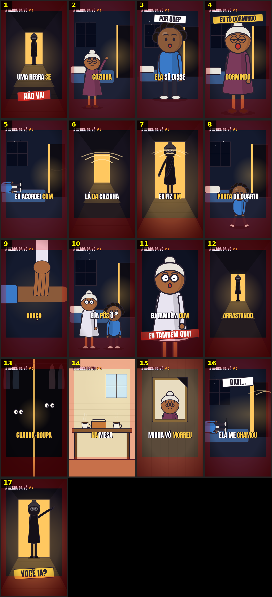

# Storyboard: regra-cozinha (flat2d)

| panel | scene | t (s) | type | title | stat |
|---|---|---|---|---|---|
| 1 | hook | 1.64 | object |  |  |
| 2 | rule | 4.36 | object |  |  |
| 3 | why | 7.03 | object |  |  |
| 4 | sleep | 9.87 | object |  |  |
| 5 | coffee | 13.1 | object |  |  |
| 6 | voice | 15.79 | object |  |  |
| 7 | fake | 19.08 | object |  |  |
| 8 | getup | 22.27 | object |  |  |
| 9 | grab | 24.45 | object |  |  |
| 10 | real | 28.65 | object |  |  |
| 11 | heard | 32.71 | object |  |  |
| 12 | steps | 37.6 | object |  |  |
| 13 | wardrobe | 42.22 | object |  |  |
| 14 | cups | 46.19 | object |  |  |
| 15 | dead | 49.1 | object |  |  |
| 16 | call | 51.99 | object |  |  |
| 17 | ask | 55.25 | object |  |  |
