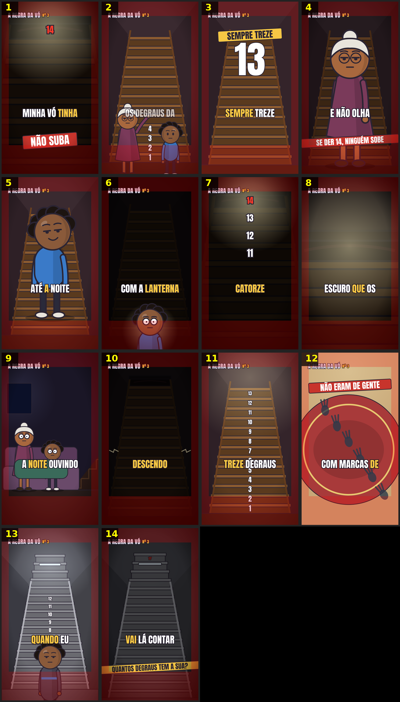

# Storyboard: regra-escada (flat2d)

| panel | scene | t (s) | type | title | stat |
|---|---|---|---|---|---|
| 1 | hook | 1.46 | object |  |  |
| 2 | rule | 4.66 | object |  |  |
| 3 | thirteen | 8.74 | object |  |  |
| 4 | warn | 13.1 | object |  |  |
| 5 | joke | 18.56 | object |  |  |
| 6 | dark | 23.98 | object |  |  |
| 7 | count | 28.16 | object |  |  |
| 8 | breath | 32.91 | object |  |  |
| 9 | sofa | 38.02 | object |  |  |
| 10 | creak | 41.06 | object |  |  |
| 11 | morning | 45.92 | object |  |  |
| 12 | rug | 54.98 | object |  |  |
| 13 | building | 63.41 | object |  |  |
| 14 | ask | 70.08 | object |  |  |
