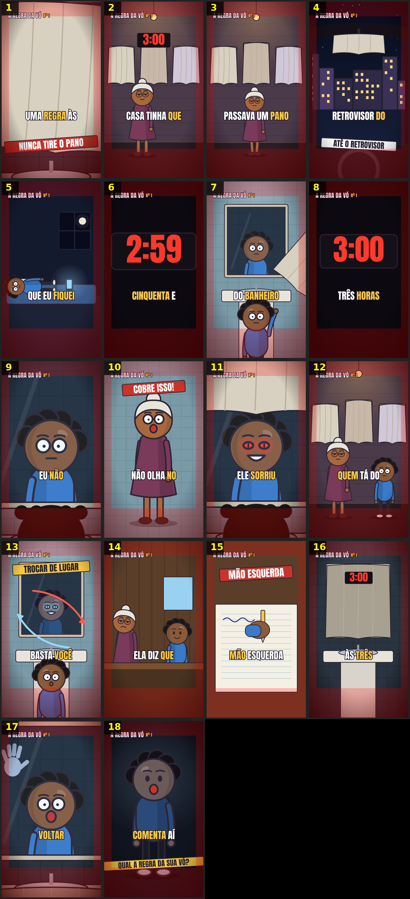

# Storyboard: regra-espelho (flat2d)

| panel | scene | t (s) | type | title | stat |
|---|---|---|---|---|---|
| 1 | hook | 1.41 | object |  |  |
| 2 | rule | 4.14 | object |  |  |
| 3 | cloths | 6.95 | object |  |  |
| 4 | car | 9.06 | object |  |  |
| 5 | awake | 12.88 | object |  |  |
| 6 | clock259 | 15.98 | object |  |  |
| 7 | pull | 18.24 | object |  |  |
| 8 | three | 20.12 | object |  |  |
| 9 | blink | 22.15 | object |  |  |
| 10 | vo | 24.65 | object |  |  |
| 11 | cover | 28.97 | object |  |  |
| 12 | explain | 32.99 | object |  |  |
| 13 | swap | 36.56 | object |  |  |
| 14 | diff | 40.02 | object |  |  |
| 15 | lefthand | 42.7 | object |  |  |
| 16 | knock | 46.67 | object |  |  |
| 17 | reveal | 49.83 | object |  |  |
| 18 | ask | 54 | object |  |  |
