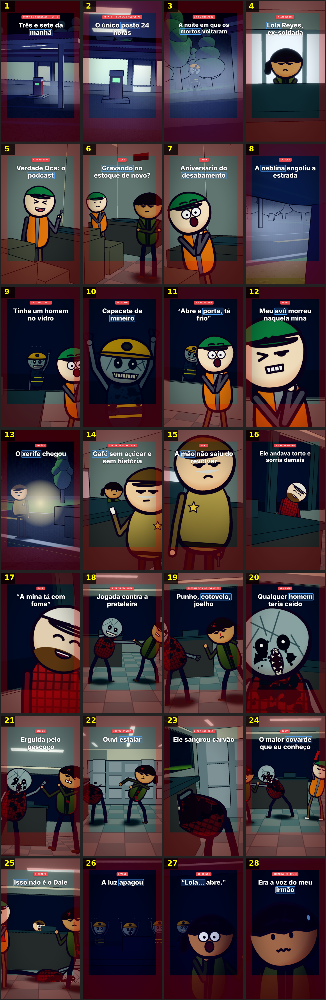

# Storyboard: turno-ep1 (2.5d_cartoon)

| panel | scene | t (s) | type | title | stat |
|---|---|---|---|---|---|
| 1 | s01 | 2.25 | object | Três e sete da manhã |  |
| 2 | s02 | 6.02 | object | O único posto 24 horas |  |
| 3 | s03 | 9.67 | object | A noite em que os mortos voltaram |  |
| 4 | s04 | 15.19 | object | Lola Reyes, ex-soldada |  |
| 5 | s05 | 21.11 | object | Verdade Oca: o podcast |  |
| 6 | s06 | 24.84 | object | Gravando no estoque de novo? |  |
| 7 | s07 | 29.78 | object | Aniversário do desabamento |  |
| 8 | s08 | 34.78 | object | A neblina engoliu a estrada |  |
| 9 | s09 | 37.75 | object | Tinha um homem no vidro |  |
| 10 | s10 | 40.92 | object | Capacete de mineiro |  |
| 11 | s11 | 45.09 | object | “Abre a porta, tá frio” |  |
| 12 | s12 | 48.62 | object | Meu avô morreu naquela mina |  |
| 13 | s13 | 53.95 | object | O xerife chegou |  |
| 14 | s14 | 59.86 | object | Café sem açúcar e sem história |  |
| 15 | s15 | 63.61 | object | A mão não saiu do revólver |  |
| 16 | s16 | 68.44 | object | Ele andava torto e sorria demais |  |
| 17 | s17 | 72.42 | object | “A mina tá com fome” |  |
| 18 | s18 | 75.93 | object | Jogada contra a prateleira |  |
| 19 | s19 | 80.13 | object | Punho, cotovelo, joelho |  |
| 20 | s20 | 83.34 | object | Qualquer homem teria caído |  |
| 21 | s21 | 85.61 | object | Erguida pelo pescoço |  |
| 22 | s22 | 89.61 | object | Ouvi estalar |  |
| 23 | s23 | 93.1 | object | Ele sangrou carvão |  |
| 24 | s24 | 97.95 | object | O maior covarde que eu conheço |  |
| 25 | s25 | 102.59 | object | Isso não é o Dale |  |
| 26 | s26 | 107.08 | object | A luz apagou |  |
| 27 | s27 | 110.24 | object | “Lola… abre.” |  |
| 28 | s28 | 114.11 | closing | Era a voz do meu irmão |  |
