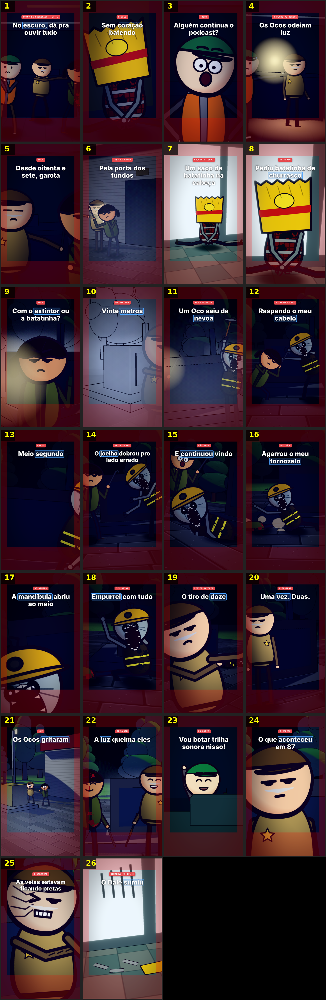

# Storyboard: turno-ep2 (2.5d_cartoon)

| panel | scene | t (s) | type | title | stat |
|---|---|---|---|---|---|
| 1 | e01 | 2.16 | object | No escuro, dá pra ouvir tudo |  |
| 2 | e02 | 5.31 | object | Sem coração batendo |  |
| 3 | e03 | 9.05 | object | Alguém continua o podcast? |  |
| 4 | e04 | 15.6 | object | Os Ocos odeiam luz |  |
| 5 | e05 | 22.62 | object | Desde oitenta e sete, garota |  |
| 6 | e06 | 26.54 | object | Pela porta dos fundos |  |
| 7 | e07 | 31.25 | object | Um saco de batatinha na cabeça |  |
| 8 | e08 | 35.97 | object | Pediu batatinha de churrasco |  |
| 9 | e09 | 40.46 | object | Com o extintor ou a batatinha? |  |
| 10 | e10 | 45.11 | object | Vinte metros |  |
| 11 | e11 | 48.54 | object | Um Oco saiu da névoa |  |
| 12 | e12 | 52.2 | object | Raspando o meu cabelo |  |
| 13 | e13 | 56.25 | object | Meio segundo |  |
| 14 | e14 | 60.29 | object | O joelho dobrou pro lado errado |  |
| 15 | e15 | 64.07 | object | E continuou vindo |  |
| 16 | e16 | 67.72 | object | Agarrou o meu tornozelo |  |
| 17 | e17 | 71.15 | object | A mandíbula abriu ao meio |  |
| 18 | e18 | 75.53 | object | Empurrei com tudo |  |
| 19 | e19 | 79.09 | object | O tiro de doze |  |
| 20 | e20 | 82.54 | object | Uma vez. Duas. |  |
| 21 | e21 | 86.89 | object | Os Ocos gritaram |  |
| 22 | e22 | 91.42 | object | A luz queima eles |  |
| 23 | e23 | 96.48 | object | Vou botar trilha sonora nisso! |  |
| 24 | e24 | 101.03 | object | O que aconteceu em 87 |  |
| 25 | e25 | 106.17 | object | As veias estavam ficando pretas |  |
| 26 | e26 | 110.6 | closing | O Dale sumiu |  |
