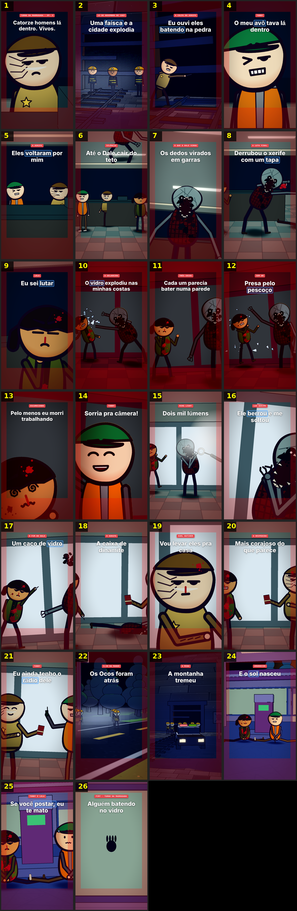

# Storyboard: turno-ep3 (2.5d_cartoon)

| panel | scene | t (s) | type | title | stat |
|---|---|---|---|---|---|
| 1 | f01 | 2.84 | object | Catorze homens lá dentro. Vivos. |  |
| 2 | f02 | 6.42 | object | Uma faísca e a cidade explodia |  |
| 3 | f03 | 10.56 | object | Eu ouvi eles batendo na pedra |  |
| 4 | f04 | 13.53 | object | O meu avô tava lá dentro |  |
| 5 | f05 | 17.36 | object | Eles voltaram por mim |  |
| 6 | f06 | 21.13 | object | Até o Dale cair do teto |  |
| 7 | f07 | 25.41 | object | Os dedos virados em garras |  |
| 8 | f08 | 29.02 | object | Derrubou o xerife com um tapa |  |
| 9 | f09 | 31.61 | object | Eu sei lutar |  |
| 10 | f10 | 34.96 | object | O vidro explodiu nas minhas costas |  |
| 11 | f11 | 39.13 | object | Cada um parecia bater numa parede |  |
| 12 | f12 | 42.74 | object | Presa pelo pescoço |  |
| 13 | f13 | 47.87 | object | Pelo menos eu morri trabalhando |  |
| 14 | f14 | 51.57 | object | Sorria pra câmera! |  |
| 15 | f15 | 55.08 | object | Dois mil lúmens |  |
| 16 | f16 | 57.76 | object | Ele berrou e me soltou |  |
| 17 | f17 | 60.71 | object | Um caco de vidro |  |
| 18 | f18 | 65.8 | object | A caixa de dinamite |  |
| 19 | f19 | 70.15 | object | Vou levar eles pra casa |  |
| 20 | f20 | 74.84 | object | Mais corajoso do que parece |  |
| 21 | f21 | 81.2 | object | Eu ainda tenho o rádio dele |  |
| 22 | f22 | 87.45 | object | Os Ocos foram atrás |  |
| 23 | f23 | 91.3 | object | A montanha tremeu |  |
| 24 | f24 | 93.58 | object | E o sol nasceu |  |
| 25 | f25 | 97.25 | object | Se você postar, eu te mato |  |
| 26 | f26 | 104.36 | closing | Alguém batendo no vidro |  |
